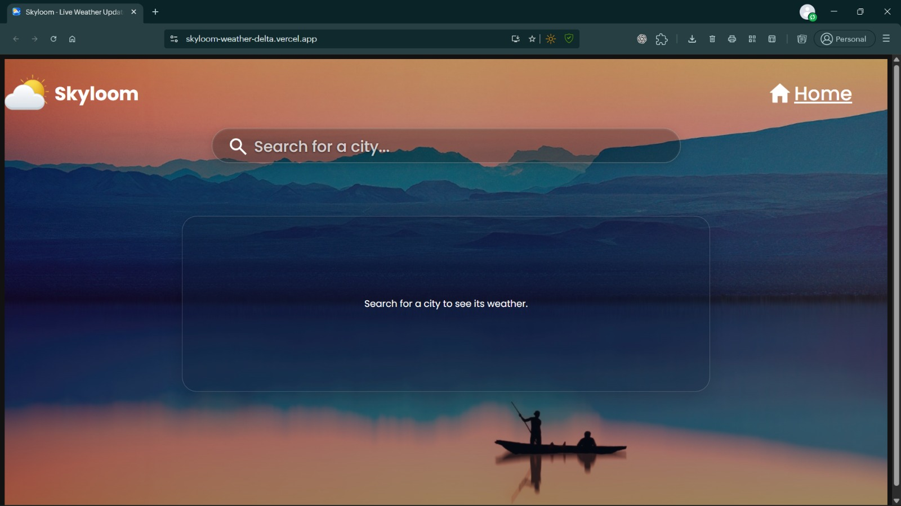
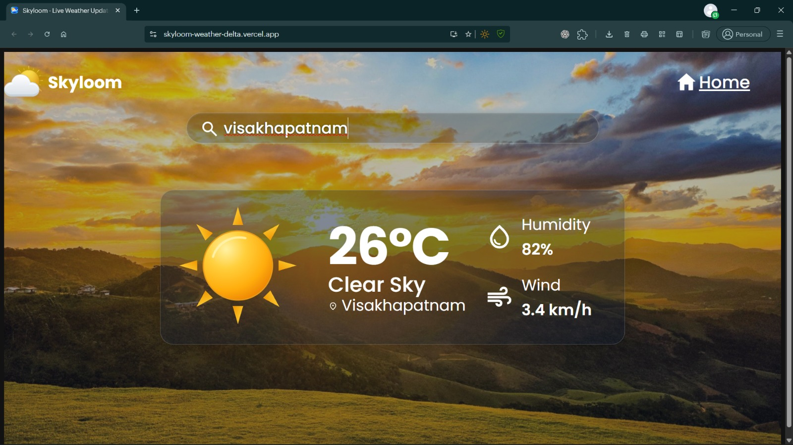
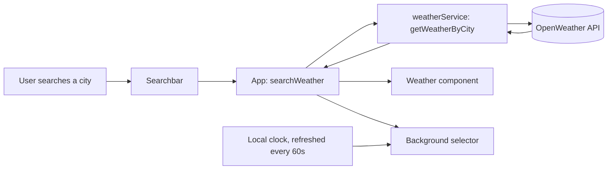

<div align="center">

# Skyloom

### A clearer view of every day.

A modern, responsive weather app that delivers real-time conditions and forecasts for any city in the world, wrapped in a backdrop that changes with the sky outside.

[](https://skyloom-weather-delta.vercel.app)

[](https://react.dev)
[](https://www.typescriptlang.org)
[](https://vitejs.dev)
[](https://tailwindcss.com)
[](https://openweathermap.org/api)
[](./LICENSE)

</div>

<p align="center">
  
  
</p>

---

## Table of Contents

- [Overview](#overview)
- [Features](#features)
- [Tech Stack](#tech-stack)
- [Getting Started](#getting-started)
- [Environment Variables](#environment-variables)
- [Available Scripts](#available-scripts)
- [Project Structure](#project-structure)
- [How It Works](#how-it-works)
- [Deployment](#deployment)
- [Roadmap](#roadmap)
- [Contributing](#contributing)
- [License](#license)
- [Acknowledgements](#acknowledgements)
- [Author](#author)

---

## Overview

**Skyloom** brings real-time weather to your fingertips. Search for any city worldwide and instantly see its temperature, conditions, humidity, wind speed, and forecast through a clean, intuitive interface.

What sets Skyloom apart is its atmosphere. The background shifts with the **time of day** (early morning, afternoon, evening, night) and the **current weather** (sunny, cloudy, rainy, snowy), so the app always looks like the sky it describes.

**Live demo:** [skyloom-weather-delta.vercel.app](https://skyloom-weather-delta.vercel.app)

---

## Features

- **Global city search**: look up weather for cities anywhere in the world.
- **Real-time conditions**: temperature, weather description, humidity, and wind speed.
- **Forecast view**: see what the coming days look like at a glance.
- **Dynamic backgrounds**: imagery adapts to both weather conditions and the local time of day.
- **Custom weather iconography**: a hand-picked SVG icon set covering sunny, partly cloudy, cloudy, drizzle, rain showers, rain, thunderstorm, snow, snow showers, fog, wind, and tornado.
- **Live local clock**: the interface refreshes automatically every minute to keep the time-based theme accurate.
- **Graceful loading and error states**: clear feedback while fetching data and when a city cannot be found.
- **Fully responsive**: designed to feel at home on phones, tablets, and desktops.
- **Type-safe codebase**: written end to end in TypeScript.

---

## Tech Stack

| Category | Technology |
| --- | --- |
| Framework | [React](https://react.dev) |
| Language | [TypeScript](https://www.typescriptlang.org) |
| Build tool | [Vite](https://vitejs.dev) |
| Styling | [Tailwind CSS](https://tailwindcss.com) |
| Data source | [OpenWeather API](https://openweathermap.org/api) |
| Linting | [Oxlint](https://oxc.rs/docs/guide/usage/linter) |
| Hosting | [Vercel](https://vercel.com) |

---

## Getting Started

### Prerequisites

- [Node.js](https://nodejs.org) **18 or later**
- npm (bundled with Node.js)
- A free [OpenWeather API key](https://home.openweathermap.org/api_keys)

### Installation

```bash
# 1. Clone the repository
git clone https://github.com/sairam-saridi/skyloom-weather.git

# 2. Move into the project directory
cd skyloom-weather

# 3. Install dependencies
npm install

# 4. Add your environment variables (see the section below)
cp .env.example .env

# 5. Start the development server
npm run dev
```

The app will be available at `http://localhost:5173`.

---

## Environment Variables

Create a `.env` file in the project root and add your OpenWeather API key:

```env
VITE_OPENWEATHER_API_KEY=your_api_key_here
```

> **Note:** Never commit your `.env` file. It is already excluded through `.gitignore`.
> Because Skyloom is a client-side app, any `VITE_` variable is bundled into the browser build. For a production-grade setup, proxy API calls through a small serverless function to keep your key private.

---

## Available Scripts

| Command | Description |
| --- | --- |
| `npm run dev` | Start the Vite development server with hot reload |
| `npm run build` | Type-check and create an optimized production build in `dist/` |
| `npm run preview` | Preview the production build locally |

---

## Project Structure

```
skyloom-weather/
├── docs/
│   └── screenshots/          # README screenshots
├── public/                   # Static assets
├── src/
│   ├── assets/
│   │   ├── backgroundImages/ # Time-of-day and weather backdrops
│   │   └── weatherImages/    # SVG weather icons
│   ├── components/
│   │   ├── Header.tsx
│   │   ├── Searchbar.tsx
│   │   └── Weather.tsx
│   ├── services/
│   │   └── weatherService.ts # OpenWeather API layer and data types
│   ├── App.tsx               # App shell, state, and background logic
│   ├── icons.tsx             # Shared icon components
│   ├── index.css             # Global styles
│   └── main.tsx              # Application entry point
├── index.html
├── vite.config.ts
├── tsconfig.json
└── package.json
```

---

## How It Works



1. The user enters a city name in the **Searchbar**.
2. **App** triggers `searchWeather`, which sets the loading state and calls the service layer.
3. **weatherService** requests data from the OpenWeather API and returns a typed `WeatherData` object.
4. The **Weather** component renders the results while the background is chosen from the weather condition and the current local hour.
5. Errors, such as an unknown city or a network failure, are caught and surfaced to the user.

---

## Deployment

Skyloom is deployed on **Vercel**. To deploy your own copy:

1. Fork this repository.
2. Import it into [Vercel](https://vercel.com/new).
3. Add `VITE_OPENWEATHER_API_KEY` under **Settings → Environment Variables**.
4. Deploy. Vercel detects Vite automatically.

---

## Roadmap

- [ ] Celsius / Fahrenheit toggle
- [ ] Detect location automatically with the Geolocation API
- [ ] Hourly forecast view
- [ ] Recent and favorite cities
- [ ] Air quality and UV index
- [ ] Installable PWA with offline support

Have an idea? [Open an issue](https://github.com/sairam-saridi/skyloom-weather/issues) and let's talk about it.

---

## Contributing

Contributions are welcome and appreciated.

1. Fork the project
2. Create your feature branch: `git checkout -b feature/amazing-feature`
3. Commit your changes: `git commit -m "Add amazing feature"`
4. Push to the branch: `git push origin feature/amazing-feature`
5. Open a pull request

Please keep changes focused and make sure `npm run build` passes before submitting.

---

## License

Distributed under the **MIT License**. See [`LICENSE`](./LICENSE) for more information.

---

## Acknowledgements

- [OpenWeather](https://openweathermap.org) for the weather data API
- [Vite](https://vitejs.dev), [React](https://react.dev), and [Tailwind CSS](https://tailwindcss.com) for an excellent developer experience
- [Vercel](https://vercel.com) for effortless hosting

---

## Author

**Sairam Saridi**

[](https://github.com/sairam-saridi)

<div align="center">

If you like Skyloom, consider giving it a star. It helps a lot.

**Skyloom: a clearer view of every day.**

</div>
